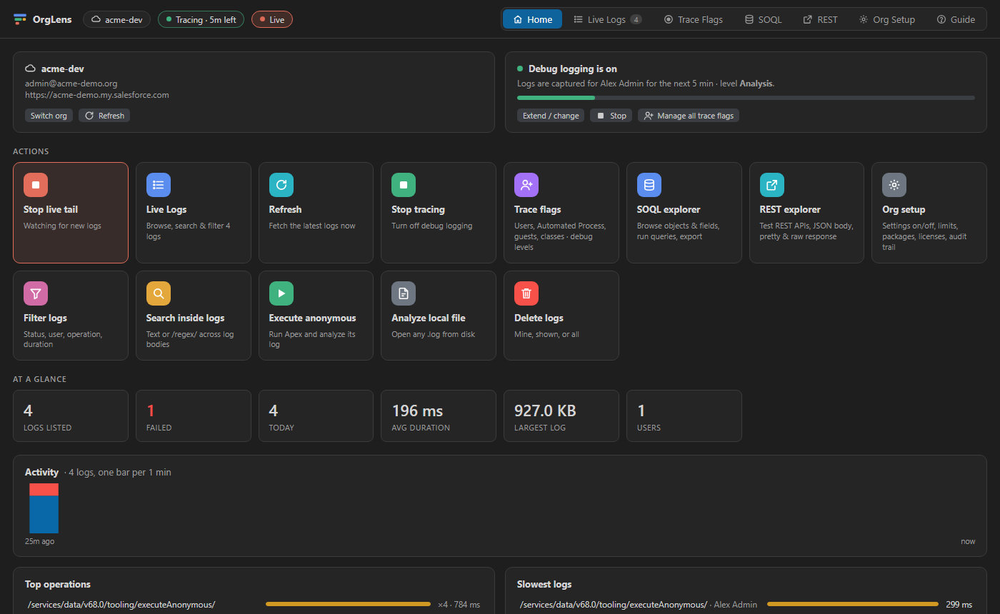
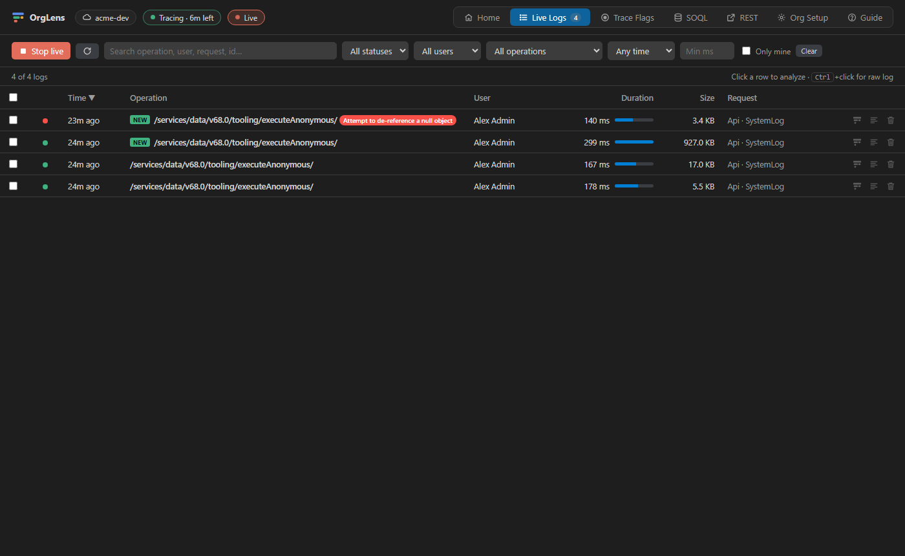
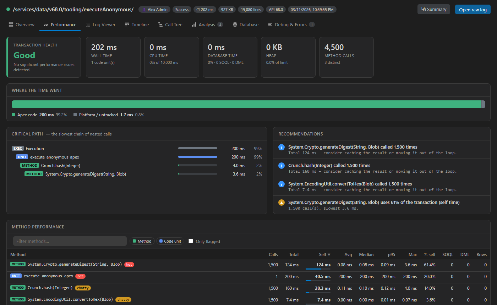
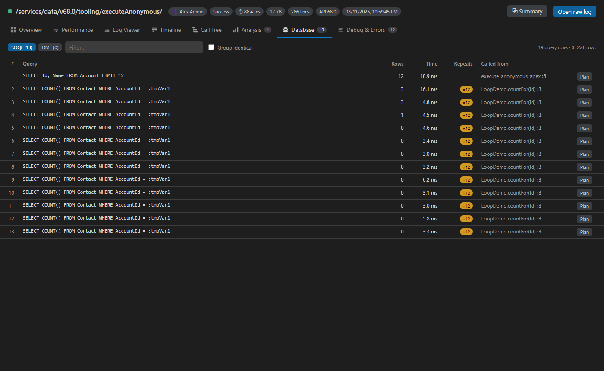
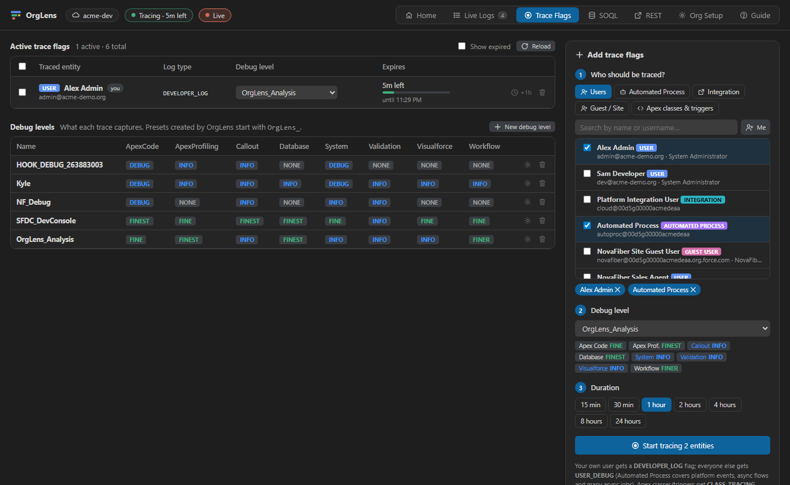
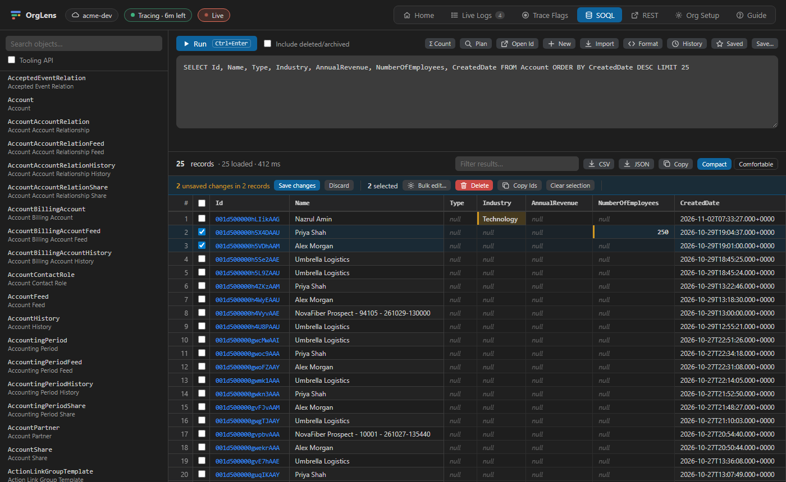
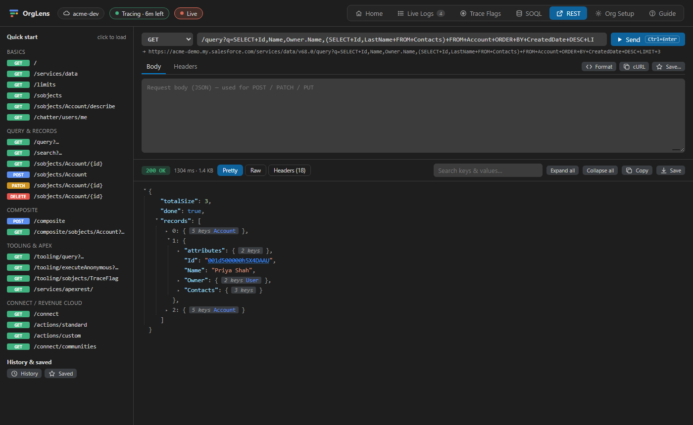

# OrgLens for Salesforce

**Debug logs, performance profiling, trace flags, SOQL data tools, REST APIs and org setup — inside VS Code.**

OrgLens gives Salesforce developers and admins one place to watch and analyze Apex debug logs, find slow code, trace any user or background process, query and fix data, test REST APIs and check how an org is configured — without leaving the editor. It signs in with the orgs you have already authorized in the Salesforce CLI, so there is nothing new to log in to.

## Features

### Debug logs, live
- **Live Logs**: every debug log in the org with search, filters (status, user, operation, time range, minimum duration, only mine), sorting and multi-select.
- **Live tail**: watches the org every few seconds, tags new logs **NEW** and notifies you or opens them automatically.
- **Search inside logs** (text or `/regex/`), bulk delete, and **Execute anonymous** Apex with its log opened straight away (`Ctrl+Alt+E`).

### Log analyzer and performance profiler
- **Overview** with automatic insights — SOQL or DML inside loops, fatal errors, limits close to the maximum, hotspots.
- **Performance**: transaction health grade, where the time went (Apex, SOQL, DML, callouts, flows), the critical path, recommendations, and per-method statistics (calls, total, self, average, median, p95, max) flagged *hot*, *slow* or *chatty*.
- **Log Viewer**: the raw log colour-coded and indented by call depth, with regex search and category filters.
- **Timeline** flame chart, **Call Tree**, **Analysis**, **Database** (every query and DML with repeat counts and live query plans) and **Debug & Errors**.

### Trace flags and debug levels
Trace yourself, any user, the **Automated Process** user, integration or guest users, or specific Apex classes and triggers — several at once, at the level and duration you choose. Extend, change or remove flags in bulk and edit debug levels.

### SOQL explorer and data editor
- Object and field browser, autocomplete (fields, relationships, picklist values), history, saved queries, CSV/JSON export.
- **Edit inline** with typed editors, batch **Save** and **Undo last save**, **bulk edit**, delete, clone.
- **Show all data** for any record — every field, related lists and parent lookups — editable in place.
- **New record** forms and **Import** from CSV or pasted Excel (insert, update, upsert, delete) with per-row results.

### REST explorer
Call any Salesforce REST endpoint with headers and a JSON body. Read the response as a **pretty, collapsible JSON tree**, raw text or headers. Quick-start requests, history, saved requests and copy-as-cURL.

### Org setup
Setup settings with every option shown as enabled or disabled (searchable across ~200 settings pages), org limits, installed packages, licenses, your permission sets and the setup audit trail.

### Built-in user guide
Open the **Guide** tab (or run **OrgLens: Open User Guide**) for an illustrated walkthrough of every feature, step-by-step workflows, keyboard shortcuts and troubleshooting.

## Requirements
- [Salesforce CLI](https://developer.salesforce.com/tools/salesforcecli) (`sf`) with at least one authorized org: `sf org login web -a my-org`.
- VS Code 1.85 or later (also available for Cursor, VSCodium and other VS Code-based editors via Open VSX).

## Getting started
1. Install OrgLens and click the OrgLens icon in the activity bar.
2. Pick an org (in a Salesforce project it uses the project's default org).
3. Click **Start tracing** on Home and choose the **Analysis** level.
4. Do something in the org, then open the log from **Live Logs**.

## Privacy and safety
- OrgLens uses your existing Salesforce CLI authorization. The session token is cached in VS Code's encrypted Secret Storage.
- Requests go only to the connected org's own instance. There is no telemetry and no third-party service.
- Every change to data, trace flags or debug levels asks for confirmation and names the org. Deletes go to the Recycle Bin.

## Settings
Search **OrgLens** in VS Code Settings: live-tail interval and new-log behaviour, default trace preset and duration, auto-extend while tailing, number of logs listed, and more.

## License
[MIT](LICENSE)

*Salesforce, Apex and related marks are trademarks of Salesforce, Inc. OrgLens is an independent project and is not affiliated with or endorsed by Salesforce.*
